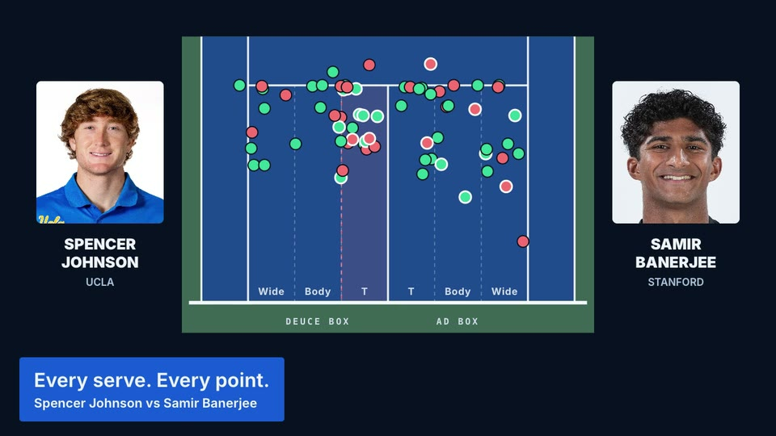
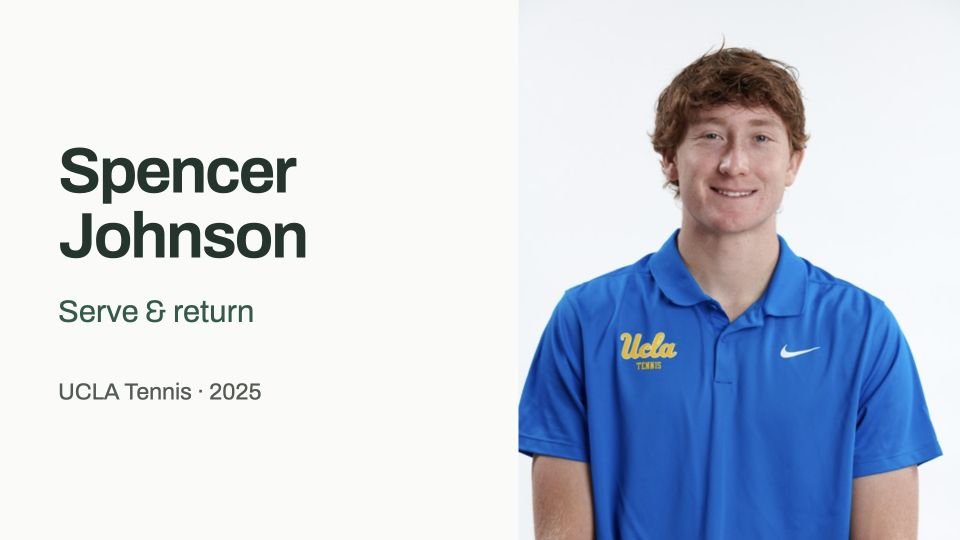
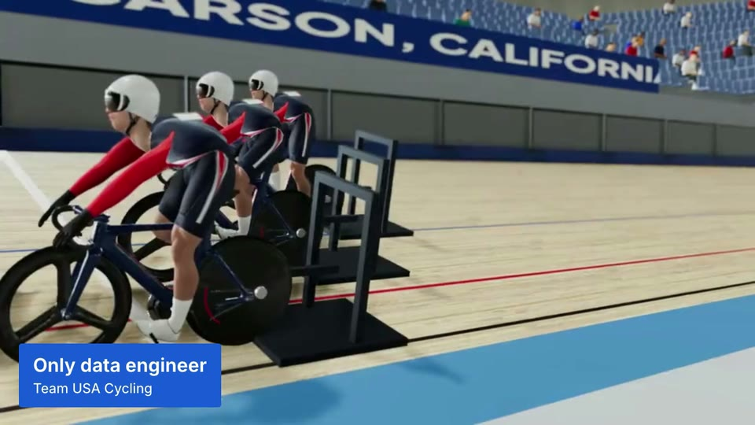
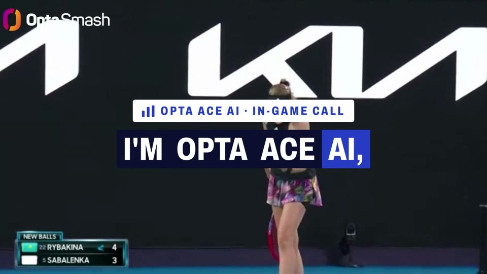

# Jerry Shi

Data engineer · LA Kings, LA Galaxy, Ontario Reign (AEG Sports)

**[Portfolio](https://jerrythegoat.com)** · [Resume](./Jerry-Shi-Resume.pdf) · [LinkedIn](https://www.linkedin.com/in/jerry-shi88)

<table>
<tr>
<td width="50%" valign="top">
 
<b><a href="https://shield-demo-nine.vercel.app">Shield · ask a business question</a></b> 
An answer, its chart, and the matching section of the sales board.
</td>
<td width="50%" valign="top">
 
<b><a href="https://jerrythegoat.com/matchviewer/">UCLA · from match data to the point</a></b> 
Search the match, inspect the pattern, watch the footage.
</td>
</tr>
<tr>
<td valign="top">
 
<b><a href="https://johnson-review.vercel.app/match">Spencer Johnson · serve and return</a></b> 
One question, the tracked points behind it, and replay on demand.
</td>
<td valign="top">
 
<b><a href="https://track-sprint-demo.vercel.app">Team USA Cycling · sprint splits</a></b> 
The race and quarter-lap timing. <a href="https://track-sprint-demo.vercel.app/?rider=remy-sprocket">Explore a rider’s splits →</a>
</td>
</tr>
<tr>
<td valign="top">
 
<b><a href="https://ai-tennis-radio.vercel.app">Stats Perform · AI tennis radio</a></b> 
Australian Open footage, generated commentary and timed captions.
</td>
<td valign="top">
 
<b><a href="https://jerryshi042003.github.io/orfeu/">Orfeu · a genre and a place each day</a></b> 
Music discovery through photographs, context and playlists.
</td>
</tr>
</table>

[AEG Sports story](https://jerrythegoat.com/galaxy/) · [US Open match prep](https://jerrythegoat.com/usta/) · [US players](https://us-tennis-players.vercel.app) · [Founding Bruin Tennis Consulting](https://jerrythegoat.com/ucla/) · [Hawk-Eye replay](https://hawkeye-3d.vercel.app)

Client work: [Toroline](https://toroline-analytics.vercel.app) · [Chinatown Market](https://market-analytics-neon.vercel.app) · Giant Robot

[Preview image credits](demos/CREDITS.md)
