# Jerry Shi

Data engineer · LA Kings, LA Galaxy, Ontario Reign (AEG Sports) · **[jerrythegoat.com](https://jerrythegoat.com)** · [Resume (PDF)](./Jerry-Shi-Resume.pdf) · [LinkedIn](https://www.linkedin.com/in/jerry-shi88)

Click any demo.

<table>
<tr>
<td width="50%" valign="top">
<b>LA Kings</b> 
<b>LA Galaxy</b> · match day, from leads to seats 
<a href="https://jerrythegoat.com/galaxy/">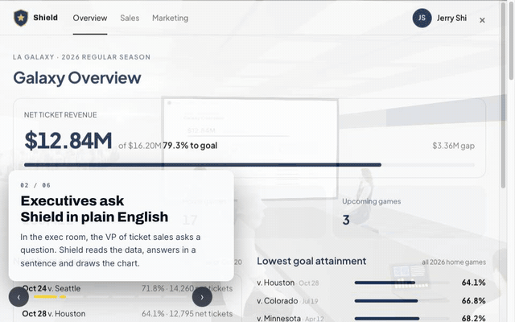</a> 
<b>Shield</b> · sales data, asked in plain English 
<a href="https://shield-demo-nine.vercel.app">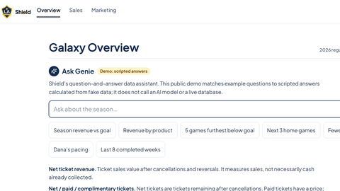</a>
</td>
<td width="50%" valign="top">
<b>Team USA Cycling</b> · velodrome splits 
<a href="https://track-sprint-demo.vercel.app">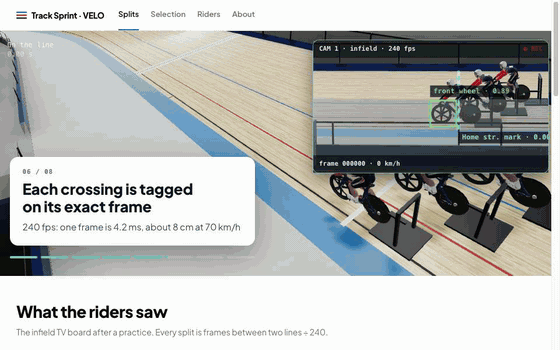</a> 
<b>Rider dashboard</b> 
<a href="https://track-sprint-demo.vercel.app/riders">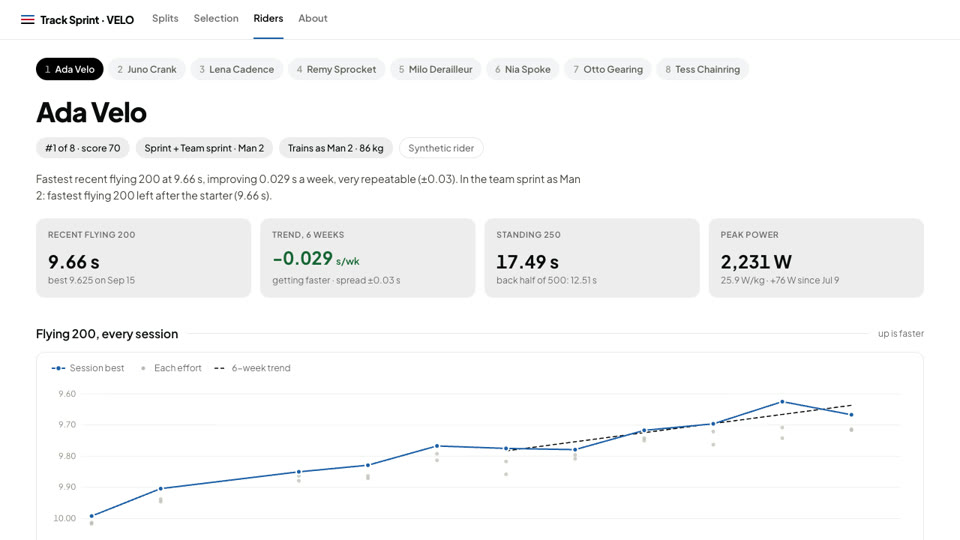</a>
</td>
</tr>
<tr>
<td valign="top">
<b>USTA</b> · Hawk-Eye prep for Ben Shelton 
<a href="https://jerrythegoat.com/usta/">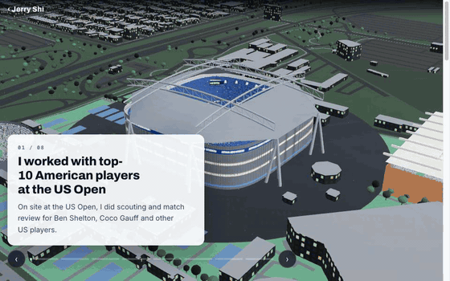</a> 
<b>What the coach sees</b> 
<a href="https://jerrythegoat.com/usta/">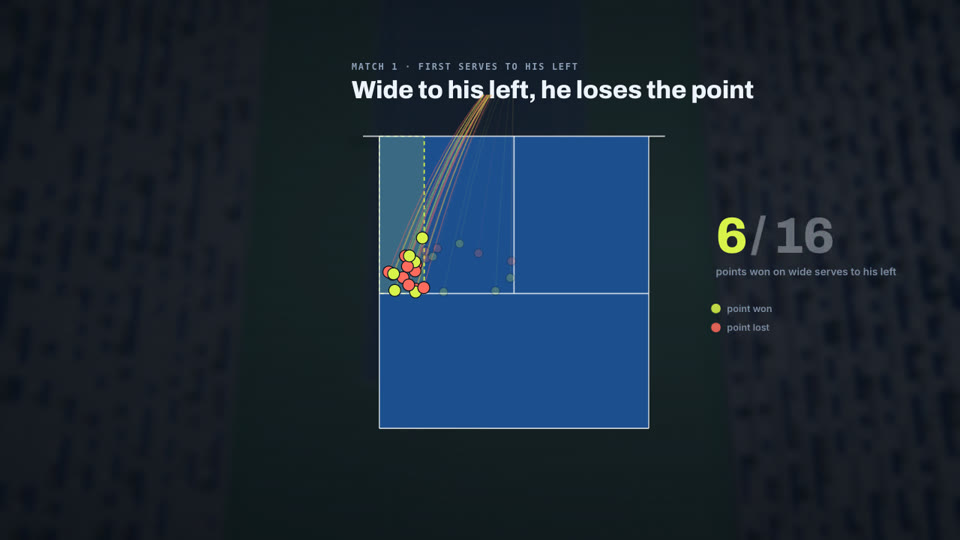</a>
</td>
<td valign="top">
<b>UCLA Tennis</b> · from zero budget to an 80-person team 
<a href="https://jerrythegoat.com/ucla/">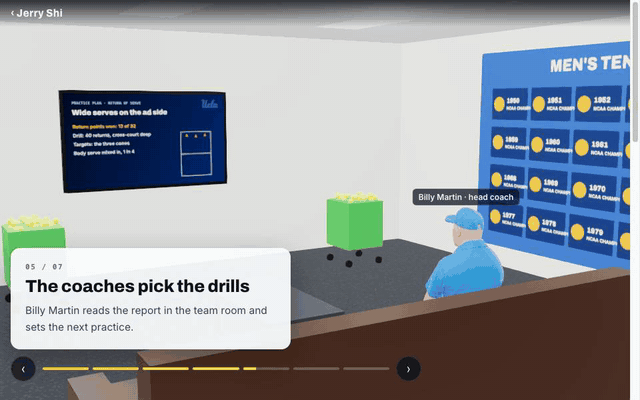</a> 
<b>What the coach sees</b> 
<a href="https://jerrythegoat.com/ucla/">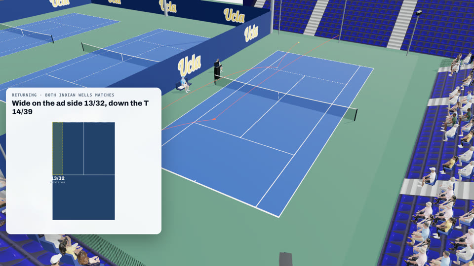</a>
</td>
</tr>
<tr>
<td valign="top">
<b>Stats Perform</b> · first AI tennis radio, Australian Open 
<a href="https://ai-tennis-radio.vercel.app">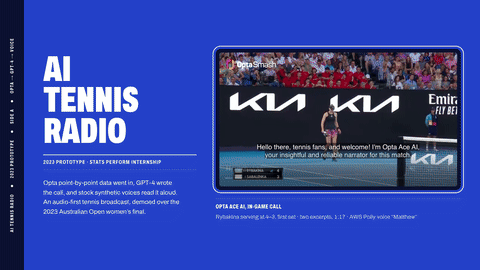</a>
</td>
<td valign="top">
<b>Clients</b> 

<a href="https://market-analytics-neon.vercel.app">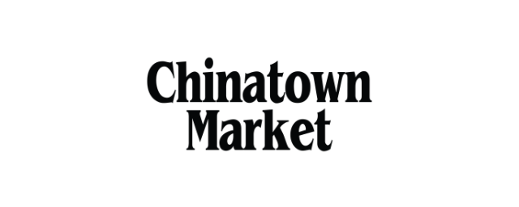</a>
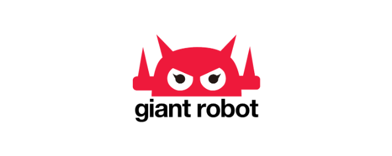
</td>
</tr>
</table>
