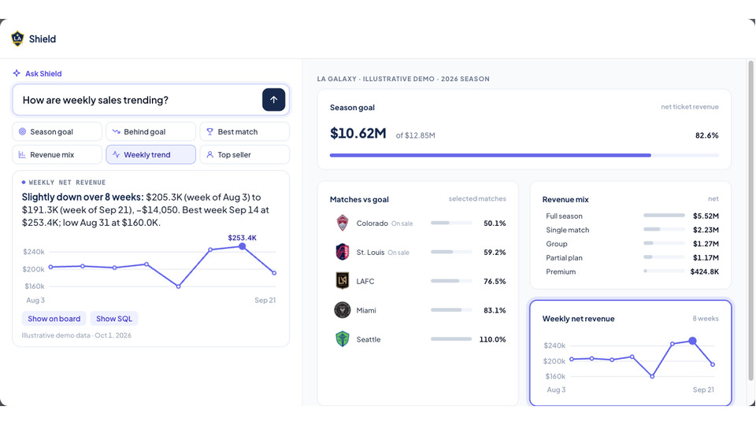
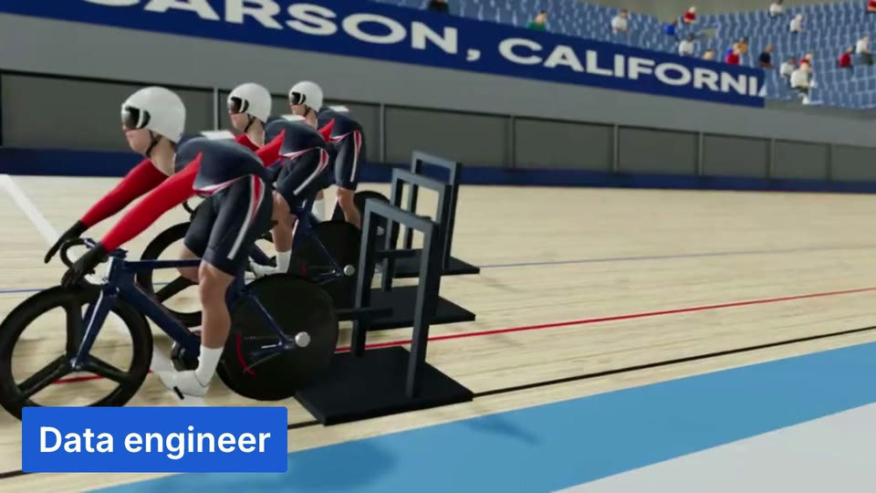
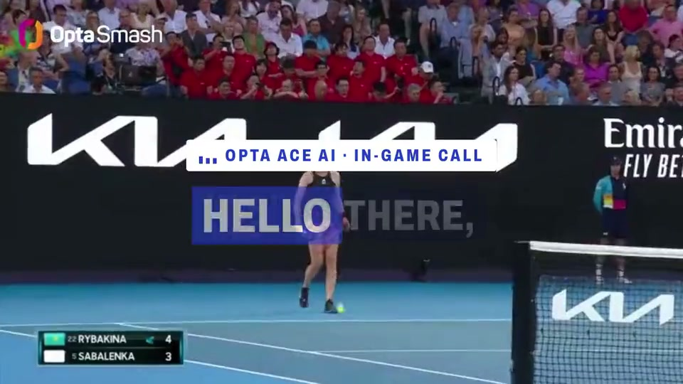

# Jerry Shi

Data engineer · LA Kings, LA Galaxy, Ontario Reign

[Portfolio](https://jerrythegoat.com) · [Resume](https://jerrythegoat.com/Jerry-Shi-Resume.pdf) · [LinkedIn](https://www.linkedin.com/in/jerry-shi88) · [Repositories](https://github.com/jerryshi042003?tab=repositories)

 

Some animations I made recently at work that I thought were cool.

 

- **Loading Shield** · built with [Thinking Logos](https://github.com/enesozturk/thinking-logos) by Enes Ozturk and [Thinking Orbs](https://github.com/Jakubantalik/thinking-orbs) by Jakub Antalik.
- **SPOM cards** · FIFA-style seller cards with holographic foil. [Framer Motion](https://github.com/motiondivision/motion) and [NumberFlow](https://github.com/barvian/number-flow).

 

- [Shield](https://jerrythegoat.com/shield/) · sports-data demo
- [Team USA Cycling](https://jerrythegoat.com/cycling/) · selection and training
- [Stats Perform](https://jerrythegoat.com/radio/) · AI tennis radio
- [Orfeu](https://jerrythegoat.com/orfeu/) · a new music culture every day

 

Favorite skills

- [Sexy Documentation](https://github.com/jerryshi042003/sexy-documentation) · [five visual demos](https://github.com/jerryshi042003/sexy-documentation#five-favorite-visual-patterns)
- [Impeccable](https://github.com/pbakaus/impeccable) · interface design and cleanup
- [HyperFrames](https://github.com/heygen-com/hyperframes) · video and motion
- [Reconstruct, clarify, validate](https://github.com/jerryshi042003/sexy-documentation/blob/main/references/my-workflows.md) · understand the business, check the request, prove the result
