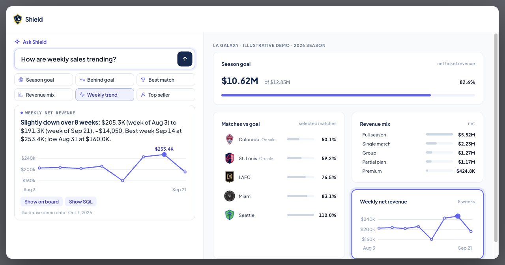

# Jerry Shi

Data engineer · LA Kings, LA Galaxy, Ontario Reign

[Portfolio](https://jerrythegoat.com) · [Resume](https://jerrythegoat.com/Jerry-Shi-Resume.pdf) · [LinkedIn](https://www.linkedin.com/in/jerry-shi88) · [Repositories](https://github.com/jerryshi042003?tab=repositories)

 

&nbsp;

&nbsp;

&nbsp;

- [Shield](https://jerrythegoat.com/shield/) · sports-data demo
- [Team USA Cycling](https://jerrythegoat.com/cycling/) · selection and training
- [Stats Perform](https://jerrythegoat.com/radio/) · AI tennis radio
- [Orfeu](https://jerrythegoat.com/orfeu/) · a new music culture every day

 

Favorite skills

- [Sexy Documentation](https://github.com/jerryshi042003/sexy-documentation) · [five visual demos](https://github.com/jerryshi042003/sexy-documentation#five-favorite-visual-patterns)
- [Impeccable](https://github.com/pbakaus/impeccable) · interface design and cleanup
- [HyperFrames](https://github.com/heygen-com/hyperframes) · video and motion
- [Business reconstruction](https://github.com/jerryshi042003/sexy-documentation/blob/main/references/my-workflows.md) · understand the business first
- [Intent + validation](https://github.com/jerryshi042003/sexy-documentation/blob/main/references/my-workflows.md) · check the request and the result
